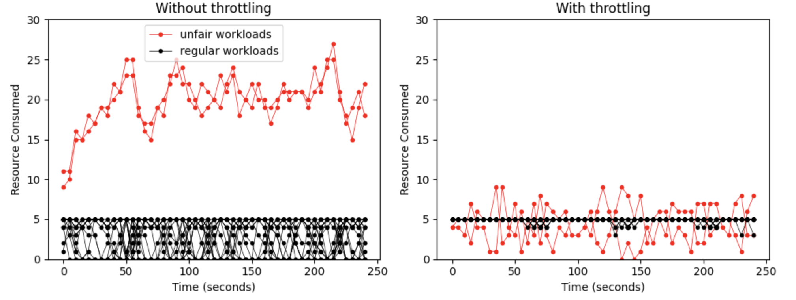

# FAIR
[](https://goreportcard.com/report/github.com/satmihir/fair)
[](https://godoc.org/github.com/satmihir/fair)

FAIR is a Go library designed to ensure fairness in resource‑constrained environments. It helps distribute limited resources evenly across multiple clients, preventing over‑allocation and starvation.

## Table of Contents
- [Introduction](#introduction)
- [Key Features](#key-features)
- [Evaluation](#evaluation)
- [Installation](#installation)
- [Quick Start](#quick-start)
  - [Request lifecycle](#request-lifecycle)
  - [Inspecting stats](#inspecting-stats)
- [Tuning](#tuning)
- [Resources](#resources)
- [License](#license)

## Introduction

The core algorithm of FAIR is based on the [Stochastic Fair BLUE](https://rtcl.eecs.umich.edu/rtclweb/assets/publications/2001/feng2001fair.pdf) often used for network congestion control with a few modifications. The philosophy of FAIR is to only throttle when there's a genuine shortage of resources as opposed to the approaches like token bucket or leaky bucket which may reject requests even when the resource is still available (a creative configuration of FAIR can enable that type of behavior, but we don't encourage it). Since the state is stored in a multi-level [Bloom Filter](https://medium.com/p/e25942ab6093) style data structure, the memory needed is constant and does not scale with the number of clients. When properly configured, FAIR can scale to a very large number of clients with a low probability of false positives and a near zero probability of persistent false-positives. The hash rotation mechanism regularly rehashes clients to avoid any correlated behavior longer than a few minutes.

### Key Features

- Framework and protocol agnostic and easy to integrate into any HTTP/GRPC service.
- Automatic tuning with minimal configuration out of the box with flexibility to fully tune if needed.
- Scalable to large numbers of clients with constant memory requirements.
- A simple resource and error tracking model that can be easily morphed into many types of throttling scenarios.

### Evaluation



In this example, 20 clients are competing for a resource that regenerates at the rate of 20/s (every data point in the graph is 5s apart). 18 out of 20 clients are "well-behaved" because they request a resource every second while the remaining two clients try to get a resource every 100ms which is an "unfair" rate. On the left, we see that when left unthrottled, the two unfair clients grab a disproportionately large amount of resource while the regular workloads starve and get a lot less than 1/s rate. On the right, when throttled with fair, the regular workloads stay virtually unaffected while the unfair ones get throttled. On average, even the unfair workloads get their fair share when seen over larger time periods.

The deterministic evaluator in `cmd/fairness_eval` compares a shared token bucket with and without FAIR. It reports Jain's fairness index over each client's allocation relative to its max-min-fair entitlement, plus resource utilization as a throughput guardrail.

```bash
go run ./cmd/fairness_eval
```

Headline results with the default FAIR configuration:

| Scenario | No FAIR Jain | FAIR Jain | Improvement | Utilization with FAIR |
| --- | ---: | ---: | ---: | ---: |
| API noisy neighbors | 0.2184 | 0.6687 | +206.2% | 99.96% |
| Batch surge | 0.7497 | 0.9969 | +33.0% | 89.36% |

[](demo/fairness_visual/fair-demo.mp4)

A browser-based visual demo for the noisy-neighbor case is available in `demo/fairness_visual`. Click the preview above to open the MP4.

The [multi-seed fairness gate](cmd/fairness_eval/README.md) checks equal-client and noisy-neighbor traffic across rotations. For request cost and rotation headroom, see the [benchmark and rollout guide](designs/production-performance.md).

## Installation

To install the FAIR library, use `go get`:

```bash
go get github.com/satmihir/fair/pkg/tracker
```

## Quick Start

The [runnable quick starts](pkg/tracker/example_test.go) include imports and expected output. From the repository root, run both with:

```bash
go test ./pkg/tracker -run '^Example' -v
```

### Request lifecycle

Follow `ExampleFairnessTracker` in the [example source](pkg/tracker/example_test.go):

1. Build one tracker for the shared resource at startup. `NewFairnessTrackerBuilder` starts with defaults; apply any setters before `Build`. Check the build error before using the tracker, and close it at shutdown.
2. Before attempting to acquire the resource, call `RegisterRequest` with a stable flow ID (for example, a tenant ID). If `ShouldThrottle` is true, reject the request immediately. FAIR makes the decision; your application enforces it. No resource was attempted, so do not report an outcome.
3. Otherwise, try to acquire the resource. With the same flow ID, report `request.OutcomeSuccess` if you obtained it or `request.OutcomeFailure` if a shortage prevented acquisition. A validation error or network timeout by itself establishes neither: report nothing. Any other outcome value is ignored.

### Inspecting stats

See `ExampleFairnessTrackerBuilder_SetIncludeStats` in the [example source](pkg/tracker/example_test.go). Call `SetIncludeStats(true)` before `Build` to inspect individual decisions. `RegisterRequest` returns optional `ResultStats` (nil by default): `FinalProbability` is the probability used for the decision, and `BucketIndexes` and `BucketProbabilities` identify the selected bucket and its probability at each level. These are not per-client request or throttle counts.

## Tuning

You can use the `GenerateTunedStructureConfig` to tune the tracker without directly touching the algorithm parameters. It exposes a simple interface where you have to pass the following things based on your application logic and scaling requirements.
- `expectedClientFlows` - Number of concurrent clients you expect to your app
- `bucketsPerLevel` - Number of buckets per level in the core structure
- `tolerableBadRequestsPerBadFlow` - Number of requests we can tolerate before we fully shut down a flow.

```go
conf, err := config.GenerateTunedStructureConfig(1000, 1000, 25)
if err != nil {
    log.Fatal(err)
}
trk, err := tracker.NewFairnessTracker(conf)
if err != nil {
    log.Fatal(err)
}
defer trk.Close()
```

Tracker construction takes a snapshot of the config, so you can reuse a builder or change the config after a successful build. A custom probability function is copied as a function value: it must still be safe to call concurrently. Its result is clamped to `[0, 1]`; if it returns NaN, the tracker uses the smallest bucket probability for that decision and logs the first occurrence. Do not change the config concurrently with construction.

For manual configurations, use positive dimensions, `0 < Pd < Pi <= 1`, a finite nonnegative `Lambda` (zero disables decay, though rotation still ends a penalty, as described below), and a non-nil probability function. `NewFairnessTracker` also needs a positive rotation interval; a manually supplied ticker controls its own cadence. Check construction and tuning errors before using the tracker.

**How long a penalty lasts:** A client's throttling probability comes down in three ways. It decays over time at rate `Lambda`, each reported success lowers it by `Pd`, and rotation eventually discards it. A structure serves for two rotation periods, first as the standby and then as the active one. A new standby starts empty and learns only from outcomes reported after it was created. A client that stays fully throttled reports no outcomes, so the standby created after its last failure never hears of it, and the client starts again from zero when that standby becomes active. That is between one and two rotation periods after its last reported failure: at most 10 minutes with the default 5-minute rotation.

This is deliberate. It limits how long a client can be penalized for sharing buckets with a misbehaving one, and it gives a blocked client another chance. `Lambda = 0` therefore disables decay, not forgiveness: with it, rotation is the only way a fully throttled client recovers. A client that is still misbehaving is blocked again after about `1/Pi` further failures. To remember penalties for longer, lengthen `RotationFrequency`; that also lengthens how long a wrongly penalized client waits.

**Allocation limit:** All constructors and the tuner reject dimensions whose estimated peak bucket storage exceeds `config.MaxRotationBytes` (64 MiB per tracker). The estimate is `3 × (4096 + L × (64 + 64 × M))` bytes: two live structures plus the replacement built on rotation, with allowances for rows, bucket objects, and pointers. This is a guardrail on dimensions, not a cap on process RSS: leave headroom for GC, concurrent requests, other trackers, and the application. If tuning exceeds the limit, revisit the expected flow count and bucket count rather than relying on a partial allocation.

**Client identifiers:** Identifiers are placed with SipHash-2-4 under a secret 128-bit key that is redrawn from `crypto/rand` for every generation, so a client that chooses its own identifier cannot aim it at another client's buckets. Every level's bucket is derived from that one 64-bit hash. Two clients with different hashes share a bucket at every level about as often as chance allows (roughly `1/M^L`); two identifiers with the same hash share every level, which bounds the rate at about `2^-64` per pair however many levels are configured. If key generation fails, construction returns an error, and a failed rotation is retried as described under [Logging](#logging).

For a reproducible simulation, set two fields on the config and leave both nil in production. `HashKeySource` is a reader that supplies the placement keys. `DecisionSource` is a function that supplies the random number behind each throttling decision; by default that comes from `math/rand`. Seeding `math/rand` with `rand.Seed` does not make decisions reproducible: it has had no effect since Go 1.24.

## Monitoring

The tracker exposes three signals. None needs a logger, and all are safe to call from any goroutine.

- `trk.Counters()` returns cumulative totals: requests registered, requests throttled, successes and failures reported, and outcomes ignored because their value was unknown. It is cheap; take the difference between two readings for a rate. A nonzero `IgnoredOutcomes` is a bug in the caller.
- `trk.Saturation()` reports how much of the active structure is carrying penalties: the number of penalized buckets at each level and the mean throttling probability. `SharedPenaltyChance()` on the result estimates how likely a client with no failures of its own is to be throttled because all of its buckets are penalized by others; the tuner aims to keep that at or below 0.0001. Watch for it rising. It means there are more misbehaving clients than the structure was sized for, or one caller is spreading failures across many identifiers, and more buckets per level are needed. The call reads every bucket, so make it from a metrics scrape rather than per request.
- `trk.RotationStatus()` reports rotation attempts, described under [Logging](#logging).

```go
c := trk.Counters()
s := trk.Saturation()
log.Printf("registered=%d throttled=%d penalized=%.4f shared=%.2g",
    c.Registered, c.Throttled, s.PenalizedFraction(), s.SharedPenaltyChance())
```

## Logging
Logging is disabled by default. If rebuilding a generation fails, the tracker keeps serving with its current pair and retries on the next tick. Poll `trk.RotationStatus()` for monitoring: `Failures` is cumulative and `LastError` clears after the next successful rotation. Neither requires enabling a logger. The retry applies to errors returned by construction, not process-level out-of-memory failures.
package `logger` exposes an interface with `GetLogger` and `SetLogger` methods.

It also provides an out of the box logger based on std lib. Here's how you can enable it:
```go
import (
	"github.com/satmihir/fair/pkg/logger"
)
logger.SetLogger(logger.NewStdLogger())
```

## Development

Run tests and static analysis locally with:

```bash
make test
```

Generate protobuff wrappers with:
```bash
make proto
```

The module needs Go 1.26 or newer. CI builds and tests on the latest Go release and on the oldest one that still receives security fixes, which is the version `go.mod` declares.

Linting needs [golangci-lint](https://github.com/golangci/golangci-lint) v2, built with a Go version at least as new as the one in `go.mod`. CI pins v2.15.0; `.golangci.yml` uses the v2 format, which v1 releases cannot read.

## Resources

- [Medium post about FAIR](https://medium.com/p/8c3a54ecee35)

## License

FAIR is released under the [MIT License](LICENSE).
